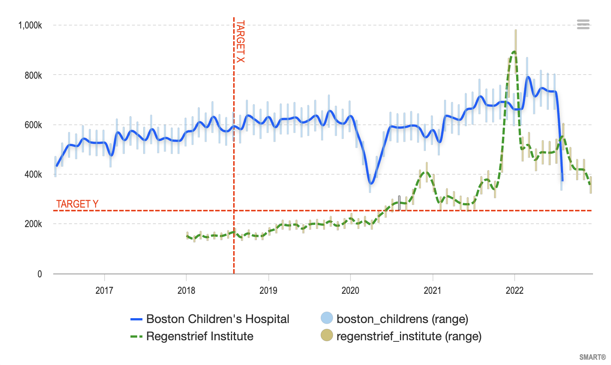
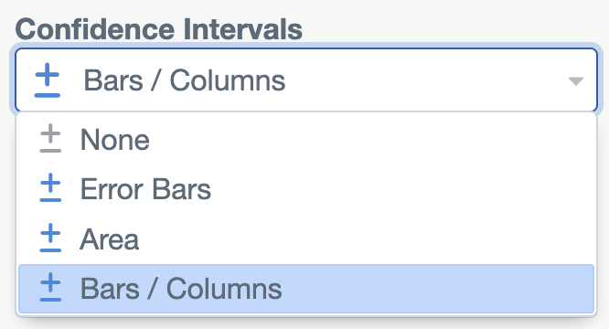

# Confidence Intervals

A chart can show a confidence interval around each count: a lower and an
upper bound, drawn as error bars, a shaded area or bars. The Dashboard shows
them only when the data has two extra count columns, `cnt_min` and `cnt_max`.

The bounds come from your data. The Dashboard does not compute them, and it
does not know or check their confidence level (for example 95%). It draws
whatever bounds the data has.



## Column names

| Column    | Required                   | Meaning                                       |
|-----------|----------------------------|-----------------------------------------------|
| `cnt`     | Yes                        | The count                                     |
| `cnt_min` | For confidence intervals   | The lower bound of the count's interval       |
| `cnt_max` | For confidence intervals   | The upper bound of the count's interval       |

- **Exact names.** The Dashboard looks for these exact names. It does not
  recognize other spellings such as `count_min` or `cnt_low`.
- **Both or neither.** If only one of `cnt_min` and `cnt_max` exists, the
  chart has no confidence intervals and shows no error.
- **Whole numbers.** Every column whose name is `cnt` or starts with `cnt_`
  is stored as an integer when the data is imported. The bounds must be
  whole numbers.
- **One value per row.** Like `cnt`, each row's bounds belong to that row's
  combination of column values.

Example cube with confidence intervals:

```csv
cnt,cnt_min,cnt_max,gender,year
1200,1150,1260,,
640,610,675,female,
560,535,590,male,
310,290,330,female,2023
330,315,350,female,2024
```

Avoid other column names that start with `cnt_`. They are stored as integers
like the count columns, but the Dashboard treats them as regular data
columns. They show up in the column pickers, and because a chart's query
expects unused data columns to be empty, rows with a value in them can drop
out of charts.

## When a chart shows confidence intervals

1. When it loads a chart's data, the Dashboard sums `cnt_min` and `cnt_max`
   for each point, the same way it sums `cnt`. Each data row then has four
   values: x, count, lower bound, upper bound.
2. If any loaded row has bounds, the **Data** section of the chart settings
   shows a **Confidence Intervals** option. Without bounds in the data, the
   option is hidden.

   

3. The user picks how to draw the intervals:

   | Option         | Drawn as                                         |
   |----------------|--------------------------------------------------|
   | None           | Not drawn                                        |
   | Error Bars     | A whisker from the lower to the upper bound      |
   | Area           | A shaded band between the bounds                 |
   | Bars / Columns | A bar from the lower to the upper bound          |

4. The choice is saved with the chart, as `ranges: { type, enabled }` in its
   settings.

## How confidence intervals are drawn

- **One interval series per series.** Each series gets a linked series for
  its intervals, with the id `primary-<name> (range)` (`secondary-…` for
  secondary data).
- **No legend item.** The intervals have no legend item of their own.
  Hiding a series in the legend hides its intervals too. To hide all
  intervals, set the **Confidence Intervals** option to **None**.
- **Gaps.** In a stratified chart, where a series has no data for an x
  value, both its line and its interval have a gap.
- **Percentages.** When the chart uses a denominator, the bounds are
  converted to percentages with the same denominator as the count.
- **Tooltips.** The tooltip shows the interval as "Range: low - high", in
  percentages when a denominator is set.
- **Secondary data.** If the secondary data has bounds, its intervals are
  drawn too.

## Data from the Aggregator

For data packages read from the Cumulus Aggregator, the Dashboard passes the
request to the Aggregator and draws whatever bounds come back, in the same
four-value row format. Whether a package returns bounds depends on the
Aggregator and on the package's data.

## Errors

The Dashboard checks the loaded data before drawing it. When rows have more
than two values, the third and fourth (the bounds) must be numbers. If
`cnt_min` or `cnt_max` is empty in every row that makes up a point, its sum
is empty, and the chart shows an "Invalid data response received" error that
names the row. Empty bounds in only some of those rows are skipped by the sum
and cause no error.

## Where this lives in the code

| Part                               | File                                          |
|------------------------------------|-----------------------------------------------|
| Count columns stored as integers   | `backend/DataManager/CSV2DB.ts`, `RemoteCsvToDb.ts` |
| Summing the bounds per point       | `backend/routes/Subscription.ts` (`/:id/api`) |
| Data checks                        | `validateData` in `src/components/Dashboard/index.tsx` |
| The Confidence Intervals option    | `src/components/Dashboard/ConfigPanel.tsx`    |
| Interval series and points         | `getSeriesAndExceptions` and `getPoint` in `src/components/Dashboard/Charts/lib.ts` |
